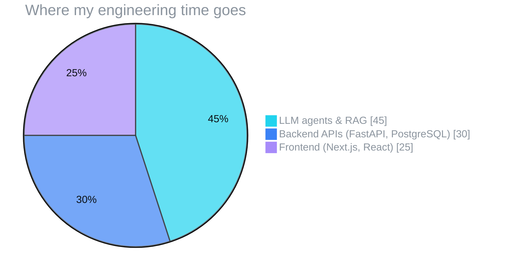

<!-- Owner: Manohar Kumar. Last reviewed: 2026-11-14.
     Review when: a new project ships, a role change, a job search starts, or a portfolio redeploy. -->

### Hi, I'm Manohar 👋

**AI Engineer building LLM agents and RAG systems with LangGraph + FastAPI, and the Next.js apps around them.**
I turn LLM prototypes into production AI apps — agents, retrieval pipelines and full-stack products that actually ship.

Currently AI Engineer at **theAppPlace (TAP) Innovations** (since June 2026). Most of my day-to-day work is in private client repositories, so the projects below are my public side of it.

The tools I use most, from AI layer to frontend:

<p>
  
</p>

### Start here

- **[agrobot](https://github.com/manohar-kumar1/agrobot)** — agentic RAG API for farmers. A LangGraph workflow classifies intent (disease, scheme or both), retrieves from Chroma, reranks, and answers with Mistral, with citations. FastAPI backend.

  How a question flows through agrobot:

  ```mermaid
  flowchart LR
      Q[Farmer question] --> I{LangGraph<br/>intent router}
      I -->|disease| D[(Disease KB)]
      I -->|scheme| S[(Scheme KB)]
      I -->|both| D & S
      D --> R[Rerank]
      S --> R
      R --> L[Mistral LLM]
      L --> A[Answer + citations]
  ```
- **[Black_coffer](https://github.com/manohar-kumar1/Black_coffer)** — MERN data-visualization dashboard with JWT auth and interactive charts. [Live demo](https://projects-dashboard.netlify.app/).
- **[Licence-Plate-Recognition-System-](https://github.com/manohar-kumar1/Licence-Plate-Recognition-System-)** — license plate detection and OCR pipeline with OpenCV and EasyOCR.

### What I've shipped at work

- Re-architected a LangGraph multi-agent system to reduce agent hopping, cutting LLM API costs by ~1.5x
- Cut API response times by ~3x by optimizing PostgreSQL queries and FastAPI hot paths
- Built a Next.js + TypeScript frontend and design system from scratch, with streaming (SSE) AI responses and page loads under 2 seconds

Roughly where my time goes (my own estimate, not measured):



**Stack:** Python · FastAPI · LangGraph · LangChain · RAG · vector databases · TypeScript · Next.js · React · Node.js · PostgreSQL

### Work with me

Open to **full-time AI / GenAI / full-stack roles** (India or remote) and **freelance AI projects**.
**→ [LinkedIn](https://www.linkedin.com/in/manohar-kumar-03k)** · manohar.kuncham03@gmail.com
